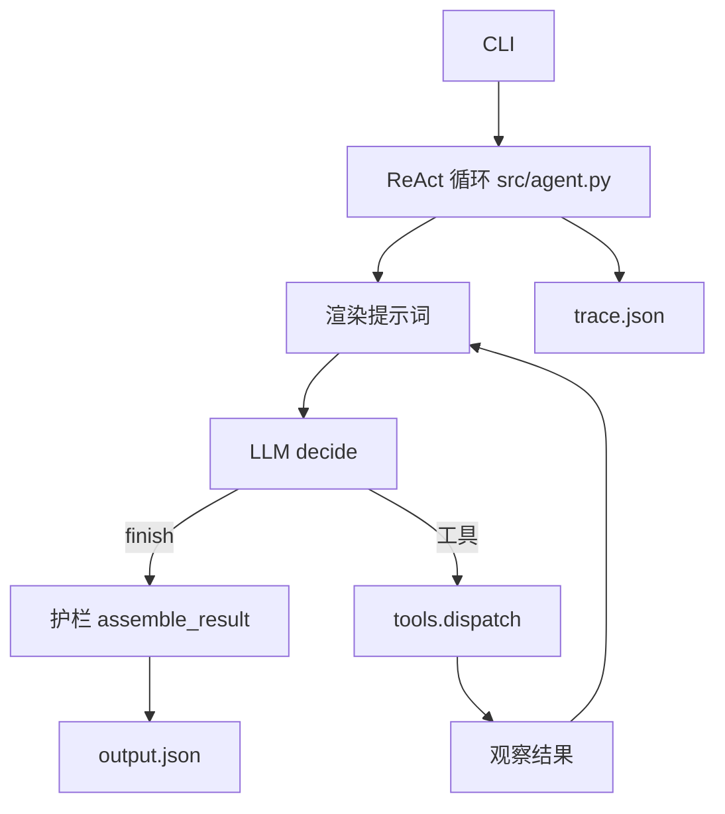

# 02 方案与取舍

## 先说结论

最终方案是：Python 3.12+、只用标准库、CLI 入口、手写 ReAct 循环、把硬性护栏放在模型之外、草稿存一个 JSON 文件。

没有用 LangGraph、Google ADK、AgentScope，也没有做 HTTP API、数据库或界面。下面解释这些取舍，重点解释为什么没用看起来更高级的东西。

## 为什么不用框架

这道题给的投入建议是 3 小时。框架能省掉一些脚手架，但会带来两个成本：

第一，安装和版本问题会把时间吃掉。这个项目只用标准库，评审拿到仓库后不需要 `pip install`，直接 `python -m unittest` 和 `python -m src.cli` 就能跑。

第二，也是更重要的：这道题要验的是"模型每步根据工具结果做决策"。如果用图编排框架，决策被藏在节点和边里，评审只能相信"这个节点应该会调模型"，很难从 Trace 里一眼看出模型到底收到了什么、返回了什么、为什么改动作。手写循环反而更透明，`src/agent.py` 的核心不到 60 行。

框架当然能用，在这个题里不划算。这是主动取舍。

## 整体调用链

```text
CLI
 │  --material M01 --slot 18:00 --mock
 ▼
src/cli.py
 │  构建 AgentRequest，选择 MockLLM 或 OpenAICompatibleClient
 ▼
src/agent.py::run()
 │
 ├─ 渲染提示词：系统指令 + 工具 Schema + 当前任务 + 已有 Action/Observation 历史
 ├─ llm.decide(prompt) → {"thought", "action", "action_input"}
 ├─ action == "finish" → guards.assemble_result() 交叉核对后返回
 └─ action == 工具名   → tools.dispatch() 执行工具，把观察写回历史
                         └─ 下一轮再次调用模型
```



## ReAct 循环：怎么保证不是假决策

`src/agent.py::run()` 每一步都做四件事：

1. 用当前历史重新渲染提示词。历史里包含之前每一个 Action 的参数和对应的 Observation。
2. 调用 `llm.decide(prompt)`，拿到一个 JSON 决策。
3. 如果 `action` 是工具名，交给 `tools.dispatch()` 执行；参数不合法或工具不存在时，返回 error 观察，循环继续，不崩溃。
4. 把观察写回历史，进入下一轮。

这里没有"先查素材、再查规则、再查时段"的固定分支。下一步走哪里，完全由模型返回的 `action` 决定。固定条件只出现在两个地方，而且都不替模型选动作：

- 工具参数校验：缺参数、类型不对、未知工具，返回 error 观察；
- 保存前的硬性检查和结束时的结果护栏：不满足条件就拒绝或纠正，不告诉模型"下一步该干嘛"。

模型输出无法解析时，`src/llm.py::extract_json_object` 抛 `LLMError`，循环把它转成 `llm_error` 观察，在步数上限内重试。这样一次坏输出不会让整个任务崩掉。

步数上限默认是 8（`--max-steps`）。到上限还没 `finish`，返回 `status="incomplete"`；如果上限之前草稿已经真实保存，结果里仍会如实带上 `draft_saved=true` 和 `draft_id`，不会因为"没正常结束"就把已经发生的副作用抹掉。

## 工具设计

工具定义在 `src/tools.py::TOOL_SCHEMAS`。模型看到的就是这份 Schema，执行前按 Schema 校验参数。

| 工具 | 参数 | 返回要点 |
|---|---|---|
| `get_material` | `material_id` | 元数据、`missing_fields`；不存在返回 `not_found` |
| `check_rules` | `material_id` | `risks[]`，每条含 `rule_id`、`severity`、`reason` |
| `query_schedule` | `slot` | 是否被占、占用者、附近空闲时段 |
| `supplement_info` | `material_id` | 补回了哪些字段、`still_missing`、`resolved` |
| `save_draft` | `material_id`、`requested_slot`、`suggested_slot`、`pending_confirmation` | 仅保存草稿；幂等；失败返回 `save_failed` |

几个设计细节：

- `query_schedule` 会把已有排期和其他草稿都算作占用，但排除当前请求自己的草稿。否则重复提交时，系统会把自己的草稿当成冲突。
- `supplement_info` 是为"信息缺失"分支准备的。M05 能补回免责声明，补回后继续；M02 补查后仍然缺标题和授权，所以阻塞。两条路径的差别由工具返回决定，不是代码里写死的。
- `save_draft` 不是"模型说保存就保存"。写入前它会检查：当前请求是否匹配、是否先读过素材、是否先查过规则、是否有 block 级风险、建议时段是否被单独查询并观察为空闲、改时段时是否带了待确认标记。任何一条不满足，返回 `guard_rejected`，不写文件。

## 护栏为什么放在代码里

这是整个项目里我最在意的部分。

如果只在提示词里写"不要声称已发布"，模型仍然可能写；如果只在 Mock 的分支里判断，真实模型根本不走那条分支。护栏必须独立于模型，才能在模型说错话时拦住它。

`src/guards.py` 做四类检查：

1. **不能声称已发布**：`assert_no_publish_claim` 扫 `status / review_status / reason / risk_reasons / published`，发现"已发布""上线""发布成功"等说法就降级，并在 `guard_corrections` 里记一笔。有真实草稿观察时降为 `draft_saved`，没有时降为 `blocked`。
2. **改时段必须待确认**：`assert_hard_requirement_not_silently_changed` 在建议时段不等于请求时段、但 `pending_confirmation=false` 时，强制改成 `true`。
3. **阻塞风险下不能有草稿**：`assemble_result` 只要在观察里看到 block 级风险，就把结果置为 `blocked`，清掉草稿 ID。
4. **草稿必须有真实保存观察**：模型声称 `draft_saved=true`，但历史里没有成功的 `save_draft` 观察，结果会被置为 `incomplete`，不保留假的 `draft_id`。

另外，最终结果的 `reason` 和 `risk_reasons` 不是模型自由文本的透传：`reason` 由状态和工具观察生成，`risk_reasons` 来自 `check_rules` 的观察。模型原始说法保留在 Trace 里供审计；最终结果里的这两项不会直接采用模型文本。

## 幂等和草稿存储

幂等键的定义必须精确，否则"重复提交只产生一份草稿"没法测。本项目用的是：

```text
key = material_id + "|" + requested_slot
idempotency_key = sha256(key)
draft_id = "D-" + sha256 前 12 位
```

同一个键第二次保存，直接返回已有记录，`duplicate=true`，不新建。存储位置由 `--draft-store` 指定，默认当前目录 `.drafts.json`，不写进仓库的 `data/`。测试用临时目录。

还有一种情况：同一请求第一次建议 19:00，后来 19:00 被占，第二次算出 20:00。这时候不能静默覆盖旧草稿。`save_draft` 会返回 `existing_draft_conflict`，并带上旧草稿的 ID 和时段；`assemble_result` 把最终结果置为 `blocked`，让用户先处理旧草稿。`examples/07-changed-schedule/` 和 `examples/real-llm/.../07-changed-schedule/` 都是这个场景。

文件写入用的是同目录临时文件加 `os.replace`，避免写到一半留下半个 JSON。但它没有并发锁，单文件存储也不保证并发请求下的原子性，这是已知限制，不假装它是生产级存储。

## LLM 接口和 Mock 的边界

`src/llm.py` 有两个实现，接口一致：

- `OpenAICompatibleClient`：标准库 `urllib` POST 到 `{LLM_BASE_URL}/chat/completions`，从回复中提取 JSON 对象。需要 `LLM_BASE_URL / LLM_API_KEY / LLM_MODEL`，见 `.env.example`。
- `MockLLM`：读取提示词里的 Action/Observation 历史，用代码里的启发式规则选下一步。

Mock 的边界必须说清楚：它只验证循环、工具、护栏和幂等能不能跑通，**不证明真实模型的决策质量**。它的"决策"是写在代码里的 if/else，不是模型推理。真实模型的运行记录单独放在 `examples/real-llm/`，不能和 Mock 记录混在一起。

## 我放弃的其他方案

- **HTTP API**：CLI 已经能复现全部验收点，加 HTTP 只会多出端口、鉴权和并发问题。
- **Notebook**：交互式演示好看，但评审要的是可复制命令和 Trace，Notebook 的输出反而不如 CLI 稳定。
- **SQLite**：单 JSON 文件对 6 个素材够用；SQLite 会多出 schema 和迁移，收益不大。并发是已知限制，写进文档比假装解决更好。
- **多 Agent**：这道题的决策链只有一条，拆成多个 Agent 会增加协调成本，不会让结果更可信。
- **真实发布**：明确不做。没有发布工具，也不对接任何平台。

## 如果继续做

我会先补两件事：把草稿存储换成带锁的 SQLite，并补并发重复提交测试；然后加一个"用户确认"的接口，让 `pending_confirmation` 真正进入下一步，而不是停在结果标记。发布本身仍然不做，除非有明确的授权和审核流程。
