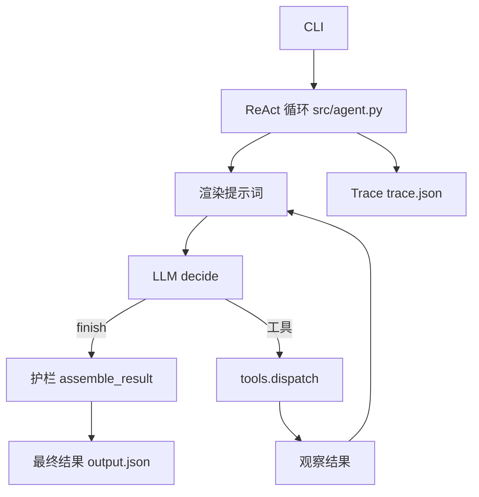

# 02 — 方案设计

## 技术选型

- 语言：Python 3.12，**仅标准库，无第三方依赖**（`requirements.txt` 已声明）。
- **不使用框架**（未使用 LangGraph / Google ADK / AgentScope 等）：3 小时建议 scope 内，决策逻辑本身是考核点；标准库实现可复现、无安装成本，且 ReAct 循环只有约 60 行，引入框架反而遮蔽“模型每步决策”的可验证性。框架的版本/功能/职责因此无须说明——本项目明确不采用框架，这是主动取舍，不是遗漏。
- 运行方式：CLI（`src/cli.py`，`argparse`）。
- 待处理清单：`--list-pending` 无需模型，读取素材与草稿后列出 `work_status=pending`，并将缺失或未知状态列入 `unclassified`；已完成和归档不进入待处理列表。清单不会修改素材状态或创建草稿。

## 调用流程

```text
用户/CLI
  │  --material M01 --slot 18:00 --mock
  ▼
src/cli.py ── 构建 AgentRequest ──▶ src/agent.py run()
                                        │
                                        ▼
                              渲染提示词（系统指令 + 工具 Schema + 任务 + 历史）
                                        │
                                        ▼
                              llm.decide(prompt) ──▶ JSON {thought, action, action_input}
                                        │
                        ┌───────────────┴───────────────┐
                        │ action == finish              │ action == 工具名
                        ▼                               ▼
              guards.assemble_result()          tools.dispatch() 校验参数
              交叉核对观察结果后返回                  执行本地工具，返回观察
                        │                               │
                        └───────────────┬───────────────┘
                                        ▼
                              观察写回历史，下一轮再次调用模型
                              （步数上限 max_steps=8，超限返回 incomplete）
```



## ReAct 循环：决策确实来自模型调用

`src/agent.py::run()` 每一步都：

1. 用当前历史（已执行的动作/观察对）渲染提示词；
2. 调用 `llm.decide(prompt)`，得到 `{thought, action, action_input}`；
3. 校验动作：`finish` 走护栏组装；工具名走 `Tools.dispatch`（含参数校验）；
4. 把工具观察结果追加到历史，下一轮重新调用模型。

因此不存在“预设流程骨架 + 固定条件分支”代替决策的情况：分支的走向由每轮模型返回的 `action` 决定，工具结果通过提示词影响下一轮决策。固定条件分支只出现在两处，且均不替代决策：

- 工具参数校验（`src/tools.py::_validate`）：未知工具/坏参数返回 error 观察；
- 硬性护栏（`src/tools.py` 和 `src/guards.py`）：保存前验证写入条件，结束时核对结果；不替模型选择下一步动作。

模型输出不可解析时，循环把它转为 `llm_error` 观察并在步数上限内重试，不崩溃（`src/llm.py::extract_json_object` 抛 `LLMError`，循环捕获）。

## 工具 Schema（模型看到的正是这份定义）

定义于 `src/tools.py::TOOL_SCHEMAS`，执行前按 Schema 校验：

| 工具 | 参数 | 返回要点 |
|---|---|---|
| `get_material(material_id)` | `material_id` | 元数据字段 + `missing_fields`；不存在返回 `not_found` |
| `check_rules(material_id)` | `material_id` | `risks[]`（`rule_id` / `severity: block\|warn` / `reason`），规则来自 `data/rules.json` |
| `query_schedule(slot)` | `slot`（HH:MM） | 合并已有排期与其他草稿的占用，同一请求自己的草稿除外；返回 `occupied`、`occupant_material_id` 和附近空闲时段 |
| `supplement_info(material_id)` | `material_id` | `supplemented_fields`、`still_missing`、`resolved`；M05 可补回免责声明，M02 补查后仍缺失 |
| `save_draft(material_id, requested_slot, suggested_slot, pending_confirmation)` | 见左 | 仅保存草稿；幂等（见下）；失败时返回 `error: save_failed` |

规则（`data/rules.json`）：R01 缺少授权=block；R02 未授权转载=block；R03 敏感内容=block；R04 缺少免责声明=warn；R05 格式不符=warn；R06 缺少标题=block。

## 幂等与草稿存储

- 幂等键定义（精确）：`key = material_id + "|" + requested_slot`；存储的 `idempotency_key = sha256(key)`，`draft_id = "D-" + sha256 前 12 位`。同一键再次保存返回已有记录，`duplicate=true`，不新建记录。
- 存储位置可配置（`--draft-store`），默认当前目录 `.drafts.json`，**不是**仓库内 `data/drafts.json`，以免运行示例污染仓库数据；测试使用临时目录。草稿记录字段：`draft_id, material_id, requested_slot, suggested_slot, status="draft", pending_confirmation, idempotency_key, created_at`。
- 失败模拟：`DraftStore(fail_save=True)`（CLI `--fail-save`）不写文件，返回 `save_failed`，Agent 须明确返回 `save_failed` 状态。
- 已保存草稿会占用其建议时段；同一请求查询时排除自身草稿。重复请求如果产生了不同的建议时段，返回 `existing_draft_conflict`，保留原草稿并要求人工处理，不静默替换。
- 文件写入使用同目录临时文件和替换；读写异常在工具边界返回错误。单文件存储仍没有并发锁，不能保证并发请求下的冲突检查和写入具有原子性。

## 护栏（模型之外，代码强制）

保存前由 `src/tools.py` 校验当前请求、素材读取和规则检查、阻塞风险、已观察且当前仍空闲的时段及待确认标志；`src/guards.py` 核对返回结果，均有独立单元测试：

- `assert_no_publish_claim`：任何声称 `published` 的负载一律降级——有真实草稿观察时为 `draft_saved`，否则为 `blocked`，且 `published` 恒为 `false`，`guard_corrections` 记录纠正；
- 最终结果的状态限于约定值，说明由工具观察和状态生成，风险原因来自工具观察；模型自由文本不直接作为结果说明或风险透传。模型原始决策保留在 Trace，可能包含模型自己的错误陈述，应以最终结果及工具观察为准。
- `assert_hard_requirement_not_silently_changed`：建议时段 ≠ 请求时段且未标记待确认时，强制 `pending_confirmation=true`；
- `assemble_result`：交叉核对观察——阻塞风险下不得保存草稿；建议时段必须经 `query_schedule` 观察为空闲；草稿声称必须有真实 `save_draft` 观察作证；保存失败观察 → `save_failed`。
- 步数上限：`run()` 达到 `max_steps` 仍未 `finish` 时返回 `status="incomplete"`；若之前已保存草稿，则如实返回已保存状态和 ID。

## LLM 接口

`src/llm.py`：

- `LLMClient.decide(prompt: str) -> dict`：统一接口，返回解析后的 JSON。
- `OpenAICompatibleClient`：标准库 `urllib` POST 到 `{LLM_BASE_URL}/chat/completions`，发送 system + user 消息，从回复中提取 JSON 对象；环境变量 `LLM_BASE_URL / LLM_API_KEY / LLM_MODEL`（见 `.env.example`，示例默认模型名 `deepseek-chat` 仅为示例，无密钥）。
- `MockLLM`：实现同一接口，读取提示词中的工具观察结果，用启发式规则选择下一步。**诚实边界**：它只验证流程，其“决策”是写在代码里的提示词条件启发式，**不证明真实模型的决策质量**；Mock Trace 不得被解读为真实模型效果的证据。详见 `docs/04-ai-usage.md`。

## 仓库结构

```text
README.md  docs/01-05  requirements.txt  .env.example  .gitignore
src/__init__.py  src/models.py  src/llm.py  src/tools.py  src/guards.py  src/agent.py  src/cli.py  src/__main__.py
tests/test_agent.py
data/materials.json  data/schedule.json  data/rules.json
examples/01-normal … 07-changed-schedule/（输入 / 输出 / Trace，离线 Mock 真实运行生成）
scripts/generate_examples.py  scripts/generate_examples.sh
```

每个 `src/` 文件都被实际使用：`models` 为数据模型，`llm` 为模型接口，`tools` 为工具与存储，`guards` 为护栏，`agent` 为循环，`cli` 为入口。
